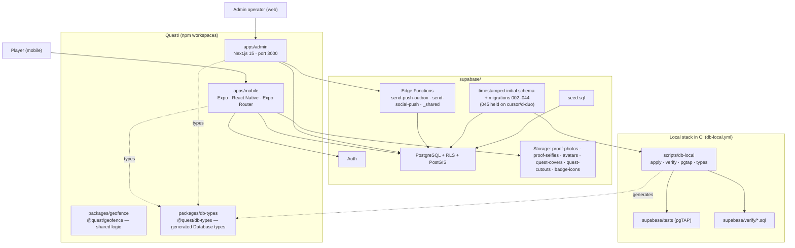
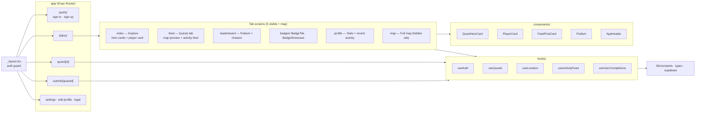
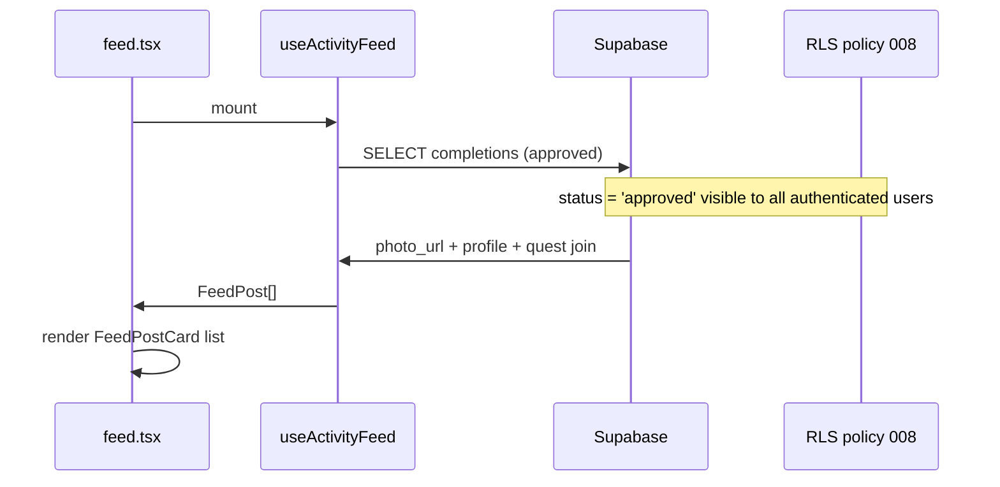
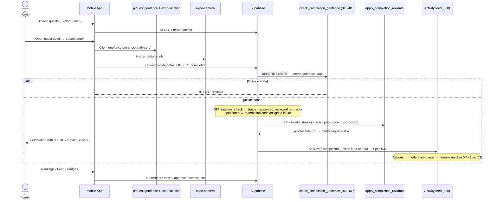
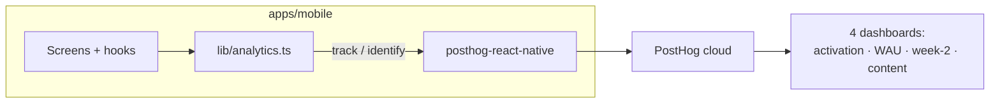
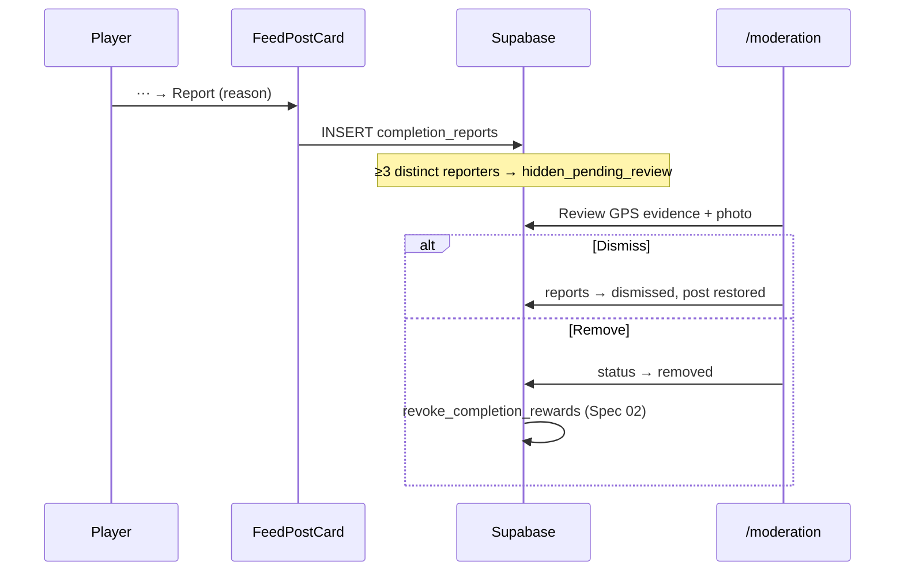

# Quest! Architecture

Visual map of the codebase — a monorepo for a gamified city quest app with a mobile client, an admin web app, and a Supabase backend. Current status: [ROADMAP.md](ROADMAP.md) (reconciled Nov 25, 2026). Earlier audit findings: [Nov 11 audit](docs/design/CODEBASE-AUDIT-2026-11-11.md).

Status words below are used strictly: **in checkout**, **locally tested**, **applied**, **deployed**, **device-verified**.

## High-level architecture



The production database has the baseline and 002–040 applied (repo-recorded). 041–044 are in
checkout and locally tested on the CI local stack; they are not applied. 045 (duo) is on
`cursor/d-duo`, held for R1, and has not yet run on a local stack. The two push functions are
not deployed. Production states come from the [campaign ledger](docs/design/QUEST-FABLE-CAMPAIGN-LEDGER.md)
and the [owner run sheet](docs/design/OWNER-RUNSHEET.md), not from this file.

## Mobile app structure



## Activity feed data flow



Requires migrations `008` (public feed RLS) and `018` (replaces the policy: feed now excludes `hidden_pending_review` posts and profiles with `feed_public = false`; client also filters blocked users).

## Geofence system (migrations 013–015)

Four zone types, all enforced **server-side** by a `BEFORE INSERT` trigger on `completions` — the mobile client's "inside quest zone" indicator is advisory UX only.

| Type | Meaning | Validation |
|---|---|---|
| `none` | Submit from anywhere (home/reflective quests) | Always passes |
| `circle` | Radius around a point (50–2000 m) | `ST_DWithin` + GPS-accuracy buffer (≤30 m) |
| `city` | Anywhere inside the city boundary | `ST_Covers` against `cities.boundary` |
| `polygon` | Hand-drawn perimeter (admin ✏️ Draw mode) | `ST_DWithin` against `quests.boundary` + accuracy buffer |

Shape data flows to clients via generated `quests.boundary_geojson`; admin writes boundaries through validated database functions. Client-side mirror logic lives in `packages/geofence` (50 geofence assertions plus redemption tests).

## Core quest flow — instant verification (shipped)

**Geofence pass = proof.** Completions auto-approve at insert (migrations `016`–`017`); XP, level, streak, and sponsored redemption codes land before the celebration modal renders. Community reports + admin moderation (migration `017`) replace the old approval queue. Specs: [02](docs/specs/02-instant-verification.md) + [03](docs/specs/03-report-moderation.md).



Anti-abuse at the same layer: rate limits (2 per 10 min, 10 per 24 h) in the `BEFORE INSERT` trigger, in-app camera only, Android mock-location block client-side.

## System map (specs 01–07)

| System | Spec | Status | Touches |
|---|---|---|---|
| Geofence drawing | [01](docs/specs/01-geofence-drawing.md) | Implemented in checkout | PostGIS geofences, admin draw/multi-area editors, `@quest/geofence` |
| Instant verification | [02](docs/specs/02-instant-verification.md) | Implemented in checkout | `completions` insert path, mobile celebration, admin log |
| Reports & moderation | [03](docs/specs/03-report-moderation.md) | Implemented in checkout | Report/block, comment moderation, feed RLS, `/moderation` |
| Analytics | [04](docs/specs/04-analytics-instrumentation.md) | Mobile wrapper present; keys and dashboards are operations (O8). Wave 2 events: N0 | `lib/analytics.ts`, PostHog in `_layout.tsx` |
| Content engine | [05](docs/specs/05-community-quests.md) | Drops and suggestions applied (034–035); push sender not deployed; chains deferred (G1) | SQL 034–035, mobile/admin flows |
| Growth & engagement | [06](docs/specs/06-growth-engagement.md) | Starter quest (037) and Sunday recap (040) applied, not device-verified. Recap push (041), XP events (043) and the offline queue are in checkout and locally tested, not applied. Duo (045) is on `cursor/d-duo`, held | SQL 037, 040, 041, 043, 045; `app/recap.tsx`, `lib/submissionQueue*`, admin `/xp-events` |
| Merchant redemption | [07](docs/specs/07-merchant-redemption.md) | 036 applied; live counter flow unverified | SQL 036, `/redeem/[merchantKey]`, `sponsors` |
| Stickers | [BRAND.md §6–§7](docs/design/BRAND.md) (no spec) | In checkout, locally tested (card S); 044 not applied | SQL 044, `stickers` / `user_stickers` / `sticker_placements`, admin `/stickers`, `hooks/useStickerPage.ts` |

Index and dependency order: [docs/specs/README.md](docs/specs/README.md). Product rationale: [PRODUCT.md](PRODUCT.md), phase plan: [ROADMAP.md](ROADMAP.md).

## Folder tree

```
Quest!/
├── apps/
│   ├── mobile/              Expo app (player-facing)
│   │   ├── app/(tabs)/      This week, Quests, City, Rankings, You
│   │   ├── components/      QuestHeroCard, PlayerCard, Podium, FeedPostCard, …
│   │   ├── hooks/           useAuth, useQuests, useActivityFeed, …
│   │   └── lib/             constants.ts, types, supabase (+ analytics.ts — Spec 04)
│   └── admin/               Next.js dashboard
│       └── app/             completions (log), moderation, quests, users, sponsors,
│                            badges, suggestions, stickers, xp-events, pilot, redeem
├── packages/
│   ├── geofence/            @quest/geofence — shared geofence and redemption logic (50 geofence assertions)
│   └── db-types/            @quest/db-types — Database types generated from the local stack (M3)
├── docs/specs/              01–07 feature specs (instant verification era)
├── docs/design/            Cutouts brand spec, UI overhaul plan, build plans and logs, ledger
├── DESIGN.md                Earlier Harbour Electric spec (superseded)
├── PRODUCT.md               Product positioning, content engine, safety
├── ROADMAP.md               Phase plan and status
├── scripts/db-local/        Throwaway local Supabase stack: apply.sh, verify.sh, pgtap.sh, types.sh, stop.sh
├── .github/workflows/       ci.yml (Node, tokens, tsc, next build, Deno, audit); db-local.yml (local stack)
└── supabase/
    ├── migrations/          timestamped initial schema + 002–044; see migrations/README.md
    ├── tests/               pgTAP suites run by scripts/db-local/pgtap.sh (53 assertions at M2)
    ├── verify/              per-migration verify SQL (039, 041–044) for the owner and CI
    ├── functions/           send-social-push, send-push-outbox; _shared/ logic + Deno tests;
    │                        deno.json (deployment and webhook state is separate)
    └── seed.sql
```

## Design system alignment

Quest! uses the **Cutouts** design direction (approved Nov 7, 2026): warm paper and ink,
one bright colour per quest category, Figtree for interface text with the Pilowlava
wordmark, real photographed cutouts you collect, place photos on every quest, and
pillow-shaped proof photos. The full spec is [docs/design/BRAND.md](docs/design/BRAND.md)
and the build plan is [docs/design/UI-OVERHAUL-PLAN.md](docs/design/UI-OVERHAUL-PLAN.md).

| Layer | Location |
|---|---|
| Spec | `docs/design/BRAND.md` |
| Mobile tokens | `apps/mobile/lib/theme.ts` (legacy `COLORS` in `lib/constants.ts` maps onto it) |
| Text primitives | `apps/mobile/components/ui/Text.tsx` |
| Copy helpers | `apps/mobile/lib/copy.js` |
| Token report | `cd apps/mobile && npm run lint:tokens` |
| Admin CSS | `apps/admin/app/globals.css` (restyled in overhaul Phase 6) |

`DESIGN.md` describes the earlier Harbour Electric spec and is kept for history.

## Analytics data flow (Spec 04 — code wired; hosted keys/dashboards remain operational)



No server-side event forwarding in v1. Sponsor redemption counts come from Postgres (Spec 07), not PostHog.

## Moderation data flow (Spec 03 — shipped, migration 018)



Feed privacy opt-out (`profiles.feed_public`, toggle in Settings) and block-user filtering (`blocked_users` + `useBlockedUsers`) shipped in the same migration. Removal notifies the owner via `apps/admin/lib/expo-push.ts`.

## Migrations and the local stack

The baseline is `20260619010246_initial_schema.sql`; numbered follow-ups run `002`–`044` in this
checkout. `045_duo_quests.sql` exists only on `cursor/d-duo`. The full list, what each file does
and its "Verifying" block live in [`supabase/migrations/README.md`](supabase/migrations/README.md),
which is the source of truth.

| Range | State |
|---|---|
| Baseline, 002–038 | Applied (recorded Nov 10, 2026) |
| 039, 040 | Applied by the owner on Nov 11, 2026. The 039 verify queries are not recorded as run |
| 041–044 | In checkout. Locally tested on the CI local stack. Not applied |
| 045 | In checkout on `cursor/d-duo`. Held for R1. Not yet run on a local stack (card M5). Not applied |
| 046–053 | Reserved by build 3 (plan §6). No files yet |

Lexical order puts the timestamped baseline after `002`, so a plain `supabase db reset` on an empty
stack fails at 002. `scripts/db-local/apply.sh` applies the baseline first, then `002`–`044`, then
the seed, against a temp project with no `migrations/` folder. `.github/workflows/db-local.yml`
runs it on pushes to `main`, `cursor/**` and `claude/**`, followed by:

1. `verify.sh`: the `supabase/verify/*.sql` pack, with owner placeholders stripped;
2. `pgtap.sh`: the suites in `supabase/tests/` (insert normalisation, privacy, push outbox,
   storage, XP, stickers, definer hygiene);
3. `types.sh --check`: regenerates `packages/db-types/src/database.ts` and fails on drift.

The mobile and admin Supabase clients are typed with `Database` from `@quest/db-types`. Edge
function logic shared by `send-push-outbox` and `send-social-push` lives in
`supabase/functions/_shared/` with injectable `fetch`, and `ci.yml` runs `deno check` and
`deno test` on it.

### History: the duplicate `push_token` migration

This is a record, not a fix. Two migrations once added the same column:

- `004_push_token.sql`: `ALTER TABLE profiles ADD COLUMN IF NOT EXISTS push_token text;`
- `20250618120000_add_push_token_to_profiles.sql`: the same statement, added in `f164d39`.

The timestamped duplicate was deleted in `b92d15d` (Jun 23, 2026), in the same commit that renamed
the baseline to `20260619010246_initial_schema.sql`. Only `004` remains in the repo. Both used
`IF NOT EXISTS`, so running either twice is harmless. Whether the hosted migration history still
holds a row for version `20250618120000` is not recorded in the repo; nothing here changes it.
Column privacy for `push_token` is a separate matter, handled by 039 (SEC-01).
