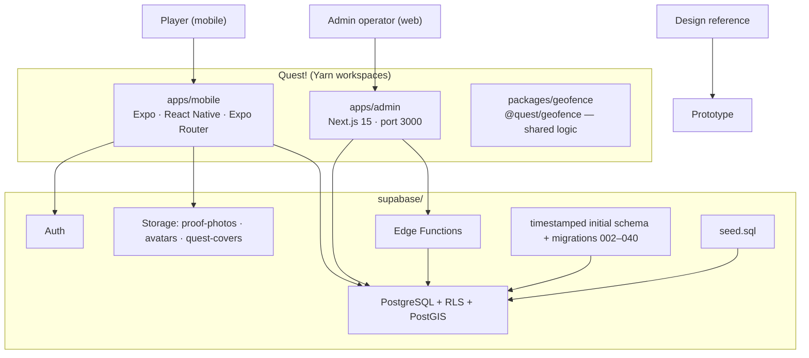
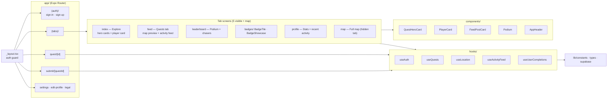
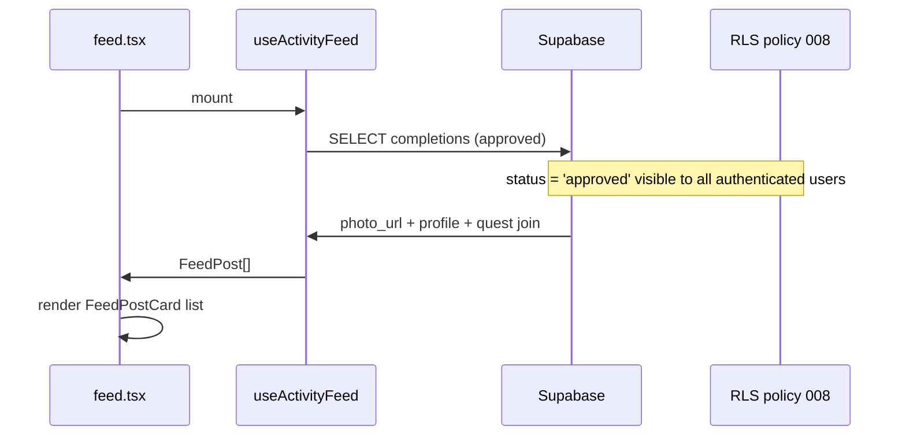
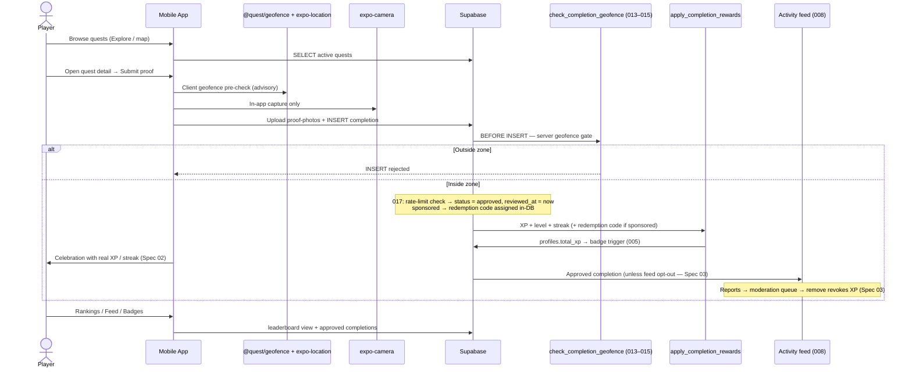
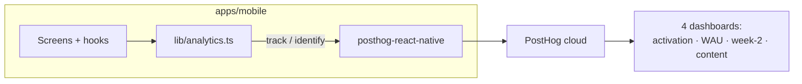
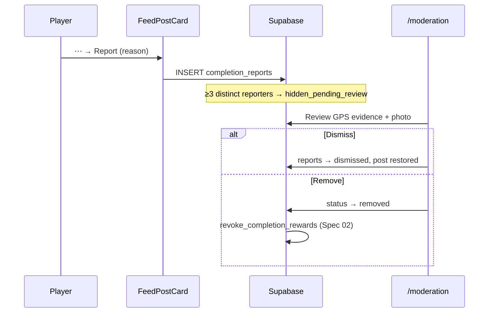

# Quest! Architecture

Visual map of the codebase — a monorepo for a gamified city quest app with a mobile client, an admin web app, and a Supabase backend. Current status and audit findings: [ROADMAP.md](ROADMAP.md) and [Nov 11 audit](docs/design/CODEBASE-AUDIT-2026-11-11.md).

## High-level architecture



## Mobile app structure



## Activity feed data flow



Requires migrations `008` (public feed RLS) and `018` (replaces the policy: feed now excludes `hidden_pending_review` posts and profiles with `feed_public = false`; client also filters blocked users).

## Geofence system (migrations 013–015)

Four zone types, all enforced **server-side** by a `BEFORE INSERT` trigger on `completions` — the mobile client's "inside quest zone" indicator is advisory UX only.

| Type | Meaning | Validation |
|---|---|---|
| `none` | Submit from anywhere (home/reflective quests) | Always passes |
| `circle` | Radius around a point (50–2000 m) | `ST_DWithin` + GPS-accuracy buffer (≤30 m) |
| `city` | Anywhere inside the city boundary | `ST_Covers` against `cities.boundary` |
| `polygon` | Hand-drawn perimeter (admin ✏️ Draw mode) | `ST_DWithin` against `quests.boundary` + accuracy buffer |

Shape data flows to clients via generated `quests.boundary_geojson`; admin writes boundaries through validated database functions. Client-side mirror logic lives in `packages/geofence` (50 geofence assertions plus redemption tests).

## Core quest flow — instant verification (shipped)

**Geofence pass = proof.** Completions auto-approve at insert (migrations `016`–`017`); XP, level, streak, and sponsored redemption codes land before the celebration modal renders. Community reports + admin moderation (migration `017`) replace the old approval queue. Specs: [02](docs/specs/02-instant-verification.md) + [03](docs/specs/03-report-moderation.md).



Anti-abuse at the same layer: rate limits (2 per 10 min, 10 per 24 h) in the `BEFORE INSERT` trigger, in-app camera only, Android mock-location block client-side.

## System map (specs 01–07)

| System | Spec | Status | Touches |
|---|---|---|---|
| Geofence drawing | [01](docs/specs/01-geofence-drawing.md) | Implemented in checkout | PostGIS geofences, admin draw/multi-area editors, `@quest/geofence` |
| Instant verification | [02](docs/specs/02-instant-verification.md) | Implemented in checkout | `completions` insert path, mobile celebration, admin log |
| Reports & moderation | [03](docs/specs/03-report-moderation.md) | Implemented in checkout | Report/block, comment moderation, feed RLS, `/moderation` |
| Analytics | [04](docs/specs/04-analytics-instrumentation.md) | Mobile wrapper present; dashboards/keys are operations | `lib/analytics.ts`, PostHog in `_layout.tsx` |
| Content engine | [05](docs/specs/05-community-quests.md) | Drops and suggestions implemented; chains deferred | SQL 034–035, mobile/admin flows |
| Growth & engagement | [06](docs/specs/06-growth-engagement.md) | Starter quest and Sunday recap implemented in checkout; other features planned | SQL 037, 040 (040 not applied); `app/recap.tsx` |
| Merchant redemption | [07](docs/specs/07-merchant-redemption.md) | Implemented in checkout; live counter flow unverified | SQL 036, `/redeem/[merchantKey]`, `sponsors` |

Index and dependency order: [docs/specs/README.md](docs/specs/README.md). Product rationale: [PRODUCT.md](PRODUCT.md), phase plan: [ROADMAP.md](ROADMAP.md).

## Folder tree

```
Quest!/
├── apps/
│   ├── mobile/              Expo app (player-facing)
│   │   ├── app/(tabs)/      This week, Quests, City, Rankings, You
│   │   ├── components/      QuestHeroCard, PlayerCard, Podium, FeedPostCard, …
│   │   ├── hooks/           useAuth, useQuests, useActivityFeed, …
│   │   └── lib/             constants.ts, types, supabase (+ analytics.ts — Spec 04)
│   └── admin/               Next.js dashboard
│       └── app/             completions (log), moderation, quests, users, sponsors
│                            (+ suggestions, merchant redemption)
├── packages/
│   └── geofence/            @quest/geofence — shared geofence and redemption logic (50 geofence assertions)
├── docs/specs/              01–07 feature specs (instant verification era)
├── docs/design/            Cutouts brand spec + UI overhaul plan
├── DESIGN.md                Earlier Harbour Electric spec (superseded)
├── PRODUCT.md               Product positioning, content engine, safety
├── ROADMAP.md               Phase plan and status
└── supabase/
    ├── migrations/          timestamped initial schema + 002–040; see migrations/README.md
    ├── functions/           send-social-push, send-push-outbox (deployment/webhook state is separate)
    └── seed.sql
```

## Design system alignment

Quest! uses the **Cutouts** design direction (approved Nov 7, 2026): warm paper and ink,
one bright colour per quest category, Figtree for interface text with the Pilowlava
wordmark, real photographed cutouts you collect, place photos on every quest, and
pillow-shaped proof photos. The full spec is [docs/design/BRAND.md](docs/design/BRAND.md)
and the build plan is [docs/design/UI-OVERHAUL-PLAN.md](docs/design/UI-OVERHAUL-PLAN.md).

| Layer | Location |
|---|---|
| Spec | `docs/design/BRAND.md` |
| Mobile tokens | `apps/mobile/lib/theme.ts` (legacy `COLORS` in `lib/constants.ts` maps onto it) |
| Text primitives | `apps/mobile/components/ui/Text.tsx` |
| Copy helpers | `apps/mobile/lib/copy.js` |
| Token report | `cd apps/mobile && npm run lint:tokens` |
| Admin CSS | `apps/admin/app/globals.css` (restyled in overhaul Phase 6) |

`DESIGN.md` describes the earlier Harbour Electric spec and is kept for history.

## Analytics data flow (Spec 04 — code wired; hosted keys/dashboards remain operational)



No server-side event forwarding in v1. Sponsor redemption counts come from Postgres (Spec 07), not PostHog.

## Moderation data flow (Spec 03 — shipped, migration 018)



Feed privacy opt-out (`profiles.feed_public`, toggle in Settings) and block-user filtering (`blocked_users` + `useBlockedUsers`) shipped in the same migration. Removal notifies the owner via `apps/admin/lib/expo-push.ts`.
